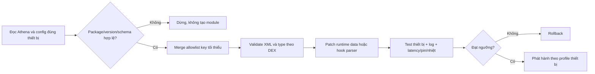

# Báo cáo đánh giá dự án Athena Universal do Gemini thực hiện

> Ngày phân tích: 2026-09-23  
> Phạm vi: phân tích offline APK CN, APK Global, APK Universal, patcher, cấu hình và module  
> Kết luận phát hành: **No-go — không flash bản hiện tại**

## 1. Kết luận điều hành

Bản vá China hiện tại **chưa vượt trội hơn Global nếu xét một sản phẩm có thể cài và vận hành an toàn**. Nó có hai lợi thế thiết kế đáng kể: giữ nền Athena CN mới hơn (`7.0.0`, target SDK 37) và mở rộng các danh sách bảo vệ từ 2 lên 42 gói. Tuy nhiên APK đầu ra không xác minh được chữ ký v3, nên tuyên bố “giữ 100% chữ ký OEM” là sai về mặt mật mã. Patcher còn chép đè 15 XML cố định lên mọi phiên bản, có lỗi sai kiểu dữ liệu và chưa có kiểm thử runtime chứng minh “0 giây trễ”, mát máy hay tiết kiệm pin.

Kết luận ngắn:

- **Ý tưởng/cấu hình:** có tiềm năng hơn Global ở độ phủ app.
- **Tính universal:** chưa đạt.
- **Khả năng cài/flash hiện tại:** không đạt.
- **Độ ổn định, pin, nhiệt:** chưa được chứng minh; whitelist 42 app thậm chí có thể tăng chạy nền.
- **Khuyến nghị:** không flash bản ZIP/APK hiện tại lên máy chính.

## 2. Phạm vi và mẫu

Scope: [work/athena-gemini-review/scope.md](work/athena-gemini-review/scope.md), `auth=granted`, `network_profile=offline`.

| Mẫu | Phiên bản | Target SDK | SHA-256 | Chữ ký |
|---|---:|---:|---|---|
| `Athena_CN.apk` | 7.0.0 (700) | 37 | `CABBB905...794864E` | v3 hợp lệ; cert `e4980240...bf9e` |
| `Athena_Global.apk` | 6.0.1 (601) | 36 | `A5347245...89026E5` | v3 hợp lệ; cert `fc98dae6...4386` |
| `Athena_Universal_Patched_OrigSig.apk` | 7.0.0 (700) | 37 | `F7BE0FD4...DF165B1` | **v3 không hợp lệ** |
| `Athena_Universal_Fix_Notification_Module.zip` | Universal-v8.0 | n/a | `347A6080...35F126` | chứa APK lỗi chữ ký |

Hai APK OEM dùng chứng thư khác nhau, nên APK Global không phải payload thay thế trực tiếp hợp lệ cho ROM China. Mục tiêu giữ nền CN và port cấu hình là hợp lý; lỗi nằm ở cách triển khai.

## 3. Bản China patch tốt hơn Global ở đâu?

| Tiêu chí | CN gốc | Global gốc | Universal hiện tại | Nhận xét |
|---|---|---|---|---|
| Nền mã | 7.0.0 / SDK 37 | 6.0.1 / SDK 36 | 7.0.0 / SDK 37 | Universal giữ nền mới hơn |
| `peculiar_kill_policy` | false | true | true | Port đúng giá trị Global |
| `always_alive_enabled` | true | false | false | Port đúng giá trị Global |
| DCS app status/client | true/true | false/false | false/false | Khớp Global |
| Swipe-up protect | 2 gói | 2 gói | 42 gói | Universal rộng hơn rõ rệt |
| Middle-priority | 2 gói | 2 gói | 42 gói | Universal rộng hơn rõ rệt |
| XML theo phiên bản máy | Có | Có | 15 file Master cố định | Universal kém an toàn hơn |
| Chữ ký | Hợp lệ | Hợp lệ | Không hợp lệ | Lỗi chặn phát hành |
| Kiểm thử thực tế | OEM | OEM | Không có bằng chứng | Không thể xác nhận 0-delay |

Vì vậy, chỉ ở tầng **chính sách whitelist dự kiến**, Universal mạnh hơn cả CN lẫn APK Global mẫu. Nhưng rộng hơn không tự động đồng nghĩa tốt hơn: giữ 42 ứng dụng, gồm GMS/GSF/MCS, mạng xã hội, giao hàng và đồng hồ, có thể tăng wakeup, RAM và pin.

## 4. Phát hiện quan trọng

### F-001 — Critical: “OrigSig Injection” không tạo chữ ký hợp lệ

`extract_apk_signing_block()` và `inject_apk_signing_block()` chép nguyên APK Signing Block từ file gốc sang file đã thay đổi. APK Signature Scheme v2/v3 ký digest của nội dung APK; sau khi tài nguyên, XML, DEX và Central Directory đổi, digest cũ không còn hợp lệ.

Kết quả `apksigner`:

```text
Athena_CN.apk: Verified using v3 scheme: true
Athena_Global.apk: Verified using v3 scheme: true
Athena_Universal_Patched_OrigSig.apk: DOES NOT VERIFY
ERROR: APK integrity check failed. CHUNKED_SHA512 digest mismatch.
```

Đây không phải cảnh báo hình thức. Android Package Manager vẫn kiểm tra tính toàn vẹn APK hệ thống. Không có khóa riêng OEM, không thể sửa nội dung rồi giữ chữ ký hợp lệ chỉ bằng cách chép Signing Block.

### F-002 — High: “Universal” thực chất là thay toàn bộ cấu hình bằng một snapshot

Trong [Universal_Athena_Patcher.py](Universal_Athena_Patcher.py), khi `Universal_Athena_Configs/assets` tồn tại, patcher chép toàn bộ XML rồi `return`. Do đó logic merge theo key phía dưới trở thành nhánh chết trong gói phát hành hiện tại.

Kiểm chứng:

- 15/15 XML của APK Universal trùng hash với Master.
- 0/15 Master trùng hoàn toàn CN gốc.
- 0/15 Master trùng hoàn toàn Global gốc.
- `sys_athena_livelock_config_list.xml` giảm từ 5.596 byte (CN) / 5.860 byte (Global) xuống 584 byte.

Điều này có thể xóa tuning theo RAM, SoC, model và schema mới của ROM đích. Một snapshot không thể chứng minh tương thích ColorOS 14–17 và mọi OPPO/OnePlus/Realme.

### F-003 — High: sai kiểu dữ liệu và một số cờ không thực sự bị tắt

Patcher đổi:

```xml
<config key="camera_start_clear_improve_appcare" type="Boolean" val="false"/>
```

Nhưng mã Athena CN gọi:

```java
getIntegerConfig("camera_start_clear_improve_appcare", 69)
```

Parser lưu Integer và Boolean ở hai map khác nhau, nên giá trị Boolean không vô hiệu hóa tính năng; code tiếp tục lấy mặc định `69`. Ngoài ra Master vẫn chỉ chứa comment `sys_level_deep_clear_switch`, nên tuyên bố đã đặt cờ này thành false không được chứng minh.

Kho Master còn có ba bản ghi `ai_battery_adaptive_clear_enabled`. Dù cùng `false`, sự trùng lặp làm thứ tự/điều kiện match khó dự đoán và là dấu hiệu thiếu kiểm thử schema.

### F-004 — Medium: module có phạm vi tác động rộng và bảo đảm runtime yếu

- Đóng cùng APK vào cả `system/system_ext/...` và `system_ext/...`; chỉ nhánh dưới `system` là cấu trúc overlay chuẩn được tài liệu Magisk mô tả.
- `customize.sh` xóa toàn bộ `/data/system/package_cache/*`, rộng hơn nhu cầu của riêng Athena.
- `service.sh` chỉ sửa whitelist nếu file đã tồn tại; không tạo file, dùng `grep -q` thay vì khớp dòng chính xác và không `restorecon` file dữ liệu.
- Không có kiểm tra package/versionCode/SDK/chứng thư/model/schema trước khi flash.
- Nâng mọi `<version>` lên `9999123199` có thể chặn OEM cập nhật cấu hình an toàn hoặc sửa lỗi về sau.

Cấu trúc `system` và vai trò của `service.sh`/`customize.sh` được đối chiếu với [Magisk Developer Guides](https://topjohnwu.github.io/Magisk/guides.html).

### F-005 — Info: bytecode nghiệp vụ nhìn chung không bị cố ý sửa

Manifest giải mã của CN và Universal không có khác biệt dòng. 2.694 file smali được so sánh; chỉ 6 file khác ở biểu diễn giá trị mặc định tĩnh (`= false`/`= null` bị rút gọn), tương đương ngữ nghĩa. Tuy vậy rebuild vẫn làm hash của cả `classes.dex` và `classes2.dex` thay đổi và đổi tên chín resource entry, nên bề mặt thay đổi lớn hơn tuyên bố “chỉ sửa XML”.

## 5. Đánh giá chất lượng dự án

| Hạng mục | Điểm | Nhận xét |
|---|---:|---|
| Ý tưởng sản phẩm | 7/10 | Giải đúng nhu cầu thông báo trên ROM China và tận dụng nền CN mới |
| Phân tích key/config | 6/10 | Tìm đúng nhiều điểm như peculiar policy, HANS, swipe-up, DCS |
| Độ chính xác triển khai | 3/10 | Sai type, key trùng, nhánh merge chết |
| Tính universal | 2/10 | Không có version/schema/device adapter; chép snapshot cố định |
| Chữ ký/đóng gói | 0/10 | APK đầu ra không xác minh; tuyên bố OrigSig sai |
| Kiểm thử và bằng chứng | 2/10 | Không có matrix thiết bị, log trước/sau, latency/pin/nhiệt |
| Tài liệu | 4/10 | Dễ làm theo nhưng có khẳng định tuyệt đối và hướng dẫn chữ ký sai |
| Mức sẵn sàng phát hành | **2/10** | No-go cho máy chính |

Đánh giá Gemini: dự án thể hiện khả năng tổng hợp và tự động hóa khá tốt, nhưng Gemini đã “điền khoảng trống” bằng các khẳng định quá mức: “mọi phiên bản”, “100% chữ ký OEM”, “0 giây trễ”, “hoàn tất 100%”. Những câu này không được chuỗi kiểm chứng hỗ trợ và ít nhất một câu bị bác bỏ trực tiếp bởi `apksigner`.

## 6. Kiến trúc nên sửa

Ưu tiên theo thứ tự:

1. **P0 — bỏ OrigSig Injection.** Không phát hành APK sửa nếu không có khóa OEM hợp lệ. Hướng thực tế là patch cấu hình runtime/data bằng module root hoặc hook parser, không thay APK.
2. **P0 — thêm fail-fast verification.** Chạy `apksigner verify`, kiểm tra package, versionCode, target SDK, cert digest; lỗi thì không tạo module.
3. **P1 — merge theo input.** Chỉ sửa allowlist key đã hiểu; giữ nguyên mọi node khác. Không chép 15 XML Master.
4. **P1 — schema registry.** Mỗi key phải khai báo file, type, phiên bản hỗ trợ, giá trị cũ/mới và assertion sau patch.
5. **P1 — giảm phạm vi.** Tách profile “chat tối thiểu”, “GMS”, “full 42 app”; mặc định không whitelist tất cả.
6. **P1 — module an toàn.** Một đường dẫn overlay, backup, rollback, update nguyên tử, `grep -Fx`, `restorecon`, không xóa toàn bộ package cache.
7. **P2 — kiểm thử thật.** Ít nhất 3 nhánh ColorOS, đo p50/p95 notification latency, RSS, wakeups, idle drain và nhiệt trước/sau trong 24–72 giờ.
8. **P2 — không khóa vĩnh viễn ROMUpdate.** Dùng version có chiến lược rollback/refresh và cho phép OEM safety fixes.

Luồng đề xuất:



## 7. Evidence → Finding → Path

| Evidence | Nội dung | Finding |
|---|---|---|
| E-001 | `apksigner` báo digest mismatch | F-001 |
| E-002 | version, SDK và chứng thư OEM | F-001, F-005 |
| E-003 | diff 15 XML và whitelist 42 gói | F-002, F-005 |
| E-004 | nhánh copy Master + lỗi type | F-002, F-003 |
| E-005 | cấu trúc ZIP và shell scripts | F-004 |

Callflow đầy đủ: [work/athena-gemini-review/paths.md](work/athena-gemini-review/paths.md). Findings có cấu trúc: [work/athena-gemini-review/findings.md](work/athena-gemini-review/findings.md). Timeline: [work/athena-gemini-review/timeline.md](work/athena-gemini-review/timeline.md).

## 8. Lệnh tái kiểm chứng

```powershell
$apksigner = 'C:\Users\KHANHSTARK\AppData\Local\Android\Sdk\build-tools\35.0.0\apksigner.bat'
& $apksigner verify --verbose --print-certs .\Athena_CN.apk
& $apksigner verify --verbose --print-certs .\Athena_Global.apk
& $apksigner verify --verbose --print-certs .\Athena_Universal_Patched_OrigSig.apk

$aapt = 'C:\Users\KHANHSTARK\AppData\Local\Android\Sdk\build-tools\37.0.0\aapt.exe'
& $aapt dump badging .\Athena_CN.apk
& $aapt dump badging .\Athena_Global.apk
& $aapt dump resources .\Athena_Universal_Patched_OrigSig.apk |
    Select-String 'peculiar_kill_policy|guardelf_associate_with_startup|guardelf_kill_sensor' -Context 0,2
```

## 9. Giới hạn phân tích

Phân tích này là static/offline. Không có thiết bị root chạy đúng ROM đích trong phạm vi kiểm thử, nên chưa xác nhận hành vi boot, PackageManager, độ trễ thông báo, tiêu thụ pin hoặc nhiệt. Các tuyên bố runtime phải được coi là chưa chứng minh cho đến khi có log và đo lường trên thiết bị.

